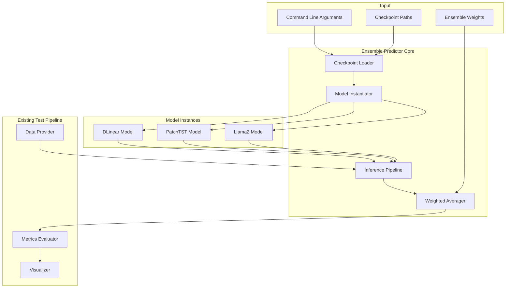
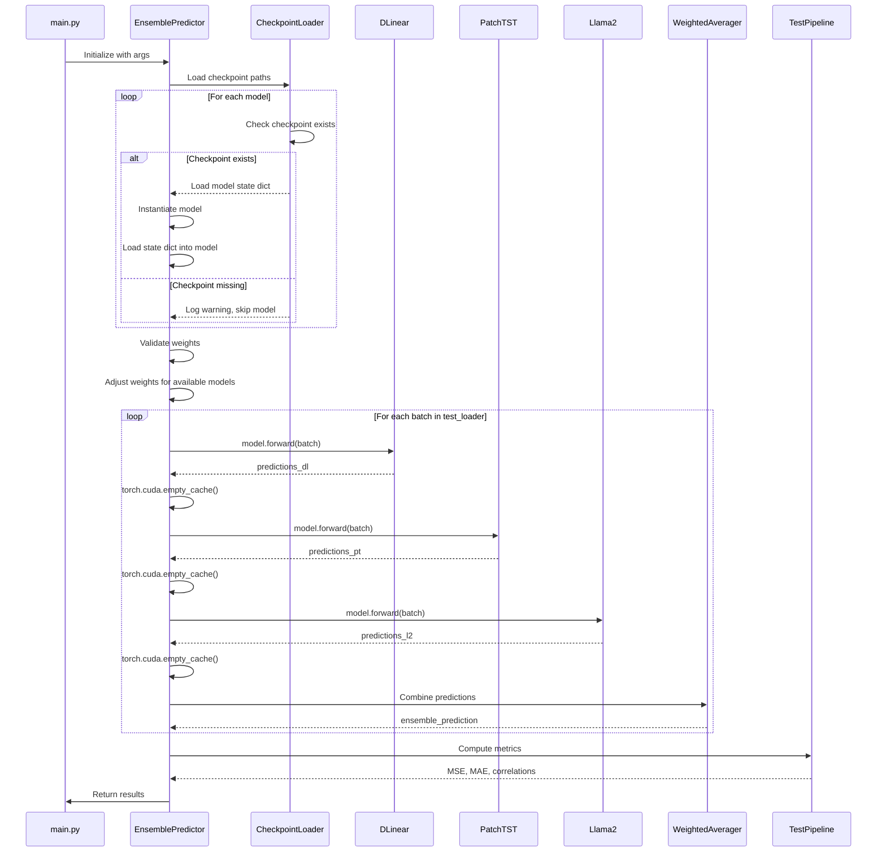

# Design Document: Ensemble Predictor for Flu Forecasting

## Overview

The Ensemble Predictor is a hybrid system that combines predictions from three pre-trained deep learning models (DLinear, PatchTST, Llama2) using weighted averaging to achieve improved forecasting accuracy for influenza-like illness (ILI) data. The design leverages the complementary strengths of different model architectures without requiring model retraining, targeting 8-15% performance improvement within a 1.5-hour implementation and evaluation timeline.

### Research Context

Ensemble forecasting is grounded in the principle that combining predictions from diverse models can balance individual strengths and weaknesses, reducing overfitting and mitigating model-specific biases ([source](https://arxiv.org/html/2506.04677)). Different models capture distinct temporal patterns—DLinear excels at trend decomposition, PatchTST at local semantic information through patching, and Llama2 at capturing complex non-linear dependencies through its transformer architecture ([source](https://arxiv.org/pdf/2603.16886v1)).

Weighted averaging remains the most transparent and computationally efficient ensemble approach ([source](https://arxiv.org/html/2306.14563)), where weights can be determined through validation set performance ([source](https://www.emergentmind.com/topics/validation-weighted-ensemble-strategy)). Research on multi-teacher knowledge distillation has demonstrated that combining DLinear, PatchTST, and similar architectures yields superior performance compared to individual models ([source](https://www.researchsquare.com/article/rs-8699707/v1.pdf)).

### Key Design Decisions

1. **Sequential Loading**: Load one model at a time to minimize GPU memory usage
2. **Static Weights**: Use pre-defined weights based on expected model performance characteristics rather than learned weights
3. **Graceful Degradation**: Continue with partial ensemble if some checkpoints are missing
4. **Integration Pattern**: Extend existing model interface to enable seamless pipeline integration

## Architecture

### High-Level Component Diagram



### Execution Flow



## Components and Interfaces

### 1. EnsemblePredictor Class

**Purpose**: Main orchestrator for ensemble prediction

**Attributes**:
- `models: Dict[str, nn.Module]` - Dictionary mapping model names to instances
- `weights: Dict[str, float]` - Dictionary mapping model names to ensemble weights
- `device: torch.device` - Target device for computation
- `configs: argparse.Namespace` - Configuration from command line arguments

**Methods**:

```python
class EnsemblePredictor(nn.Module):
    def __init__(self, args: argparse.Namespace, device: torch.device):
        """
        Initialize ensemble predictor with configuration.
        
        Args:
            args: Command-line arguments containing checkpoint paths, weights, etc.
            device: Target device (CPU/GPU) for model execution
        """
        
    def load_checkpoints(self) -> None:
        """
        Load all available model checkpoints from disk.
        Handles missing checkpoints gracefully by logging warnings.
        Updates self.models dictionary with loaded models.
        """
        
    def validate_weights(self) -> None:
        """
        Validate ensemble weights sum to 1.0 within tolerance.
        Normalize if needed and log warnings.
        Adjust weights if some models are unavailable.
        """
        
    def forward(self, x: torch.Tensor, itr: int) -> torch.Tensor:
        """
        Generate ensemble prediction for input batch.
        
        Args:
            x: Input tensor [batch_size, seq_len, features]
            itr: Iteration number (for compatibility with existing interface)
            
        Returns:
            Ensemble prediction tensor [batch_size, pred_len, features]
        """
        
    def compute_ensemble(self, predictions: Dict[str, torch.Tensor]) -> torch.Tensor:
        """
        Compute weighted average of model predictions.
        
        Args:
            predictions: Dictionary mapping model names to prediction tensors
            
        Returns:
            Weighted ensemble prediction tensor
        """
```

### 2. CheckpointLoader Module

**Purpose**: Handle checkpoint discovery and loading with error handling

**Interface**:

```python
def load_checkpoint(
    model_type: str,
    checkpoint_path: str,
    device: torch.device,
    args: argparse.Namespace
) -> Optional[nn.Module]:
    """
    Load a single model checkpoint.
    
    Args:
        model_type: One of ['DLinear', 'PatchTST', 'Llama2']
        checkpoint_path: Path to checkpoint.pth file
        device: Target device
        args: Configuration arguments
        
    Returns:
        Loaded model instance or None if loading fails
        
    Raises:
        FileNotFoundError: If checkpoint file doesn't exist (caught internally)
        RuntimeError: If model instantiation fails
    """

def discover_checkpoints(
    checkpoints_dir: str,
    model_types: List[str],
    iteration: int = 0
) -> Dict[str, str]:
    """
    Discover checkpoint paths for specified models.
    
    Args:
        checkpoints_dir: Base checkpoint directory
        model_types: List of model types to discover
        iteration: Iteration number (itr0, itr1, itr2)
        
    Returns:
        Dictionary mapping model_type to checkpoint path
    """
```

### 3. WeightedAverager Module

**Purpose**: Compute weighted average of predictions

**Interface**:

```python
def weighted_average(
    predictions: List[torch.Tensor],
    weights: List[float]
) -> torch.Tensor:
    """
    Compute weighted average of prediction tensors.
    
    Args:
        predictions: List of prediction tensors with same shape
        weights: List of weights (must sum to 1.0)
        
    Returns:
        Weighted average tensor
        
    Raises:
        ValueError: If predictions have different shapes
        ValueError: If weights don't sum to 1.0 within tolerance
    """

def normalize_weights(weights: List[float]) -> List[float]:
    """
    Normalize weights to sum to 1.0.
    
    Args:
        weights: List of raw weights
        
    Returns:
        Normalized weights summing to 1.0
    """
```

### 4. Integration Adapter

**Purpose**: Adapt EnsemblePredictor to work with existing test pipeline

**Interface**:

```python
def create_ensemble_model(args: argparse.Namespace, device: torch.device) -> nn.Module:
    """
    Factory function to create ensemble model matching existing model interface.
    
    Args:
        args: Command-line arguments
        device: Target device
        
    Returns:
        EnsemblePredictor instance compatible with existing pipeline
    """
```

## Data Models

### Configuration Structure

```python
@dataclass
class EnsembleConfig:
    """Configuration for ensemble predictor."""
    
    # Checkpoint paths
    dlinear_checkpoint: str = "./checkpoints/DLinear_full_sl336_ll18_pl8_dm768_nh16_el3_gl6_df512_ebtimeF_itr0/checkpoint.pth"
    patchtst_checkpoint: str = "./checkpoints/PatchTST_full_sl336_ll18_pl8_dm768_nh16_el3_gl6_df512_ebtimeF_itr0/checkpoint.pth"
    llama2_checkpoint: str = "./checkpoints/Llama2_full_sl336_ll18_pl13_dm4096_nh16_el3_gl6_df512_ebtimeF_itr0/checkpoint.pth"
    
    # Ensemble weights [DLinear, PatchTST, Llama2]
    weights: List[float] = field(default_factory=lambda: [0.3, 0.3, 0.4])
    
    # Iteration ensemble settings
    enable_iteration_ensemble: bool = False
    num_iterations: int = 3  # itr0, itr1, itr2
    
    # Memory management
    sequential_loading: bool = True  # Load one model at a time
    clear_cache_after_inference: bool = True
    
    # Validation
    weight_tolerance: float = 0.001  # Tolerance for weight sum validation
```

### Prediction Data Structure

```python
@dataclass
class PredictionBatch:
    """Container for model predictions."""
    
    dlinear_pred: Optional[torch.Tensor] = None  # [batch_size, pred_len, features]
    patchtst_pred: Optional[torch.Tensor] = None
    llama2_pred: Optional[torch.Tensor] = None
    ensemble_pred: Optional[torch.Tensor] = None
    
    def available_predictions(self) -> List[Tuple[str, torch.Tensor]]:
        """Return list of (model_name, prediction) for available predictions."""
        predictions = []
        if self.dlinear_pred is not None:
            predictions.append(('DLinear', self.dlinear_pred))
        if self.patchtst_pred is not None:
            predictions.append(('PatchTST', self.patchtst_pred))
        if self.llama2_pred is not None:
            predictions.append(('Llama2', self.llama2_pred))
        return predictions
```

### Evaluation Metrics Structure

```python
@dataclass
class EnsembleMetrics:
    """Metrics for ensemble evaluation."""
    
    # Individual model metrics
    dlinear_mse: Optional[float] = None
    dlinear_mae: Optional[float] = None
    patchtst_mse: Optional[float] = None
    patchtst_mae: Optional[float] = None
    llama2_mse: Optional[float] = None
    llama2_mae: Optional[float] = None
    
    # Ensemble metrics
    ensemble_mse: float = 0.0
    ensemble_mae: float = 0.0
    ensemble_corr_spearman: float = 0.0
    ensemble_corr_pearson: float = 0.0
    
    # Improvement calculations
    mse_improvement_pct: Dict[str, float] = field(default_factory=dict)
    mae_improvement_pct: Dict[str, float] = field(default_factory=dict)
    
    def compute_improvements(self) -> None:
        """Compute percentage improvements over individual models."""
        for model, mse in [('DLinear', self.dlinear_mse), 
                          ('PatchTST', self.patchtst_mse),
                          ('Llama2', self.llama2_mse)]:
            if mse is not None:
                self.mse_improvement_pct[model] = ((mse - self.ensemble_mse) / mse) * 100
                
    def meets_target(self, target_min: float = 8.0, target_max: float = 15.0) -> bool:
        """Check if any improvement meets target range."""
        return any(target_min <= imp <= target_max 
                  for imp in self.mse_improvement_pct.values())
```


## Correctness Properties

*A property is a characteristic or behavior that should hold true across all valid executions of a system—essentially, a formal statement about what the system should do. Properties serve as the bridge between human-readable specifications and machine-verifiable correctness guarantees.*

### Property Reflection

After analyzing all acceptance criteria, I identified the following properties suitable for property-based testing:

**Testable Properties:**
1. Output shape consistency (Requirements 2.1, 2.2, 2.3, 4.1) - Can be combined into one property
2. Weighted average computation (Requirement 3.2)
3. Weight validation (Requirement 3.4)
4. Weight normalization (Requirement 3.5)
5. Percentage improvement calculation (Requirement 6.4)
6. Weight adjustment for missing models (Requirement 8.2)
7. Weight input validation (Requirement 9.3)
8. Iteration averaging (Requirement 10.2)
9. Order of operations for iteration+model ensemble (Requirement 10.3)

**Redundancy Analysis:**
- Properties 2.1, 2.2, 2.3, and 4.1 all test output shape consistency → Combine into Property 1
- Properties 3.4 and 3.5 are related (validation and normalization) → Keep separate as they test different aspects
- Properties 8.2 and 3.5 both involve normalization → Keep separate as 8.2 tests adjustment for missing models while 3.5 tests general normalization
- Properties 10.2 and 10.3 test iteration ensemble but different aspects → Keep both

**Final Property Set (9 properties):**

### Property 1: Prediction Shape Consistency

*For any* valid input tensor with shape [batch_size, seq_len, features] and any loaded model (DLinear, PatchTST, Llama2, or Ensemble), the output prediction SHALL have shape [batch_size, pred_len, features].

**Validates: Requirements 2.1, 2.2, 2.3, 4.1**

**Rationale**: This property ensures that all models and the ensemble maintain consistent output dimensions, which is critical for downstream pipeline integration. The shape should be preserved regardless of batch size or input features.

### Property 2: Weighted Average Correctness

*For any* set of N prediction tensors {P1, P2, ..., PN} with identical shapes and any weight vector W = {w1, w2, ..., wN} where sum(W) = 1.0, the weighted ensemble prediction SHALL equal sum(wi * Pi) for all i.

**Validates: Requirement 3.2**

**Rationale**: This is the core mathematical property of weighted averaging. The ensemble must compute the exact weighted sum of individual predictions. This property ensures the fundamental ensemble operation is correct.

### Property 3: Weight Sum Validation

*For any* weight vector W = {w1, w2, ..., wN}, the weight validation function SHALL return true if and only if |sum(W) - 1.0| <= tolerance (0.001).

**Validates: Requirement 3.4**

**Rationale**: Weight validation is critical for ensemble correctness. This property ensures the validation logic correctly identifies valid and invalid weight vectors across all possible inputs.

### Property 4: Weight Normalization Idempotence

*For any* weight vector W = {w1, w2, ..., wN} with all wi > 0, after normalization to W' = normalize(W), the sum of W' SHALL equal 1.0 within tolerance AND normalize(W') SHALL equal W' (idempotence).

**Validates: Requirement 3.5**

**Rationale**: Normalization must produce weights that sum to 1.0, and applying normalization twice should not change the result (idempotence property). This ensures normalization is correct and stable.

### Property 5: Percentage Improvement Calculation

*For any* two non-negative metric values baseline_metric and ensemble_metric, the percentage improvement SHALL equal ((baseline_metric - ensemble_metric) / baseline_metric) * 100.

**Validates: Requirement 6.4**

**Rationale**: Improvement percentage is a key metric for evaluating ensemble performance. This property ensures the calculation is mathematically correct for all metric values.

### Property 6: Weight Adjustment for Missing Models

*For any* subset of available models (1 to 3 models) and any initial weight vector W, after weight adjustment for missing models, the adjusted weights for available models SHALL sum to 1.0 within tolerance.

**Validates: Requirement 8.2**

**Rationale**: When models are unavailable, the ensemble must adjust weights to maintain a valid probability distribution. This property ensures graceful degradation with correct weight rebalancing.

### Property 7: Weight Input Validation

*For any* input string representing weights, the validation function SHALL correctly identify valid inputs (comma-separated non-negative floats) and reject invalid inputs (non-numeric, negative, malformed strings).

**Validates: Requirement 9.3**

**Rationale**: Input validation prevents runtime errors and ensures only valid weight configurations are accepted. This property covers all possible input strings.

### Property 8: Iteration Averaging Correctness

*For any* set of K prediction tensors {P1, P2, ..., PK} from different iterations of the same model with identical shapes, the iteration-averaged prediction SHALL equal sum(Pi) / K for all elements.

**Validates: Requirement 10.2**

**Rationale**: Iteration averaging reduces variance by combining predictions from multiple training runs. This property ensures the averaging is mathematically correct.

### Property 9: Two-Stage Ensemble Composition

*For any* set of model predictions where each model has M iterations {P_model1[i1, i2, ..., iM], P_model2[...], ...}, and weights W_models, the final ensemble SHALL equal weighted_avg(W_models, [avg(P_model1), avg(P_model2), ...]), NOT weighted_avg(W_models, [P_model1[i1], P_model2[i1], ...]).

**Validates: Requirement 10.3**

**Rationale**: The order of operations matters: first average iterations within each model, then apply model weights. This property ensures correct composition of the two-stage ensemble and prevents incorrect cross-iteration mixing.

## Error Handling

### Error Categories and Handling Strategies

#### 1. Checkpoint Loading Errors

**Scenarios**:
- Checkpoint file not found
- Checkpoint file corrupted or incompatible format
- Model architecture mismatch with checkpoint
- Insufficient memory to load checkpoint

**Handling**:
- Log warning with checkpoint path and error details
- Continue execution with remaining available models
- If all checkpoints fail, terminate with clear error message listing all failed paths
- Provide suggestions for resolution (e.g., check checkpoint directory, verify paths)

**Implementation**:
```python
try:
    model.load_state_dict(torch.load(checkpoint_path))
except FileNotFoundError:
    logger.warning(f"Checkpoint not found: {checkpoint_path}")
    logger.warning(f"Continuing with {len(available_models)} available models")
except RuntimeError as e:
    logger.error(f"Failed to load checkpoint {checkpoint_path}: {e}")
    logger.error("Checkpoint may be incompatible with model architecture")
```

#### 2. Weight Configuration Errors

**Scenarios**:
- Weights don't sum to 1.0
- Negative weights provided
- Wrong number of weights
- Non-numeric weight values
- Weights sum to zero

**Handling**:
- For sum != 1.0: Normalize and log warning
- For negative weights: Terminate with error (negative weights are mathematically invalid)
- For wrong count: Terminate with error specifying expected vs. actual count
- For non-numeric: Terminate with error showing invalid value
- For zero sum: Terminate with error (cannot normalize)

**Implementation**:
```python
def validate_and_normalize_weights(weights: List[float]) -> List[float]:
    if any(w < 0 for w in weights):
        raise ValueError(f"Negative weights not allowed: {weights}")
    
    weight_sum = sum(weights)
    if weight_sum == 0:
        raise ValueError("Weights sum to zero, cannot normalize")
    
    if abs(weight_sum - 1.0) > 0.001:
        logger.warning(f"Weights sum to {weight_sum}, normalizing to 1.0")
        weights = [w / weight_sum for w in weights]
    
    return weights
```

#### 3. Memory Errors

**Scenarios**:
- Out of GPU memory during model loading
- Out of GPU memory during inference
- Out of system memory for large batches

**Handling**:
- Clear GPU cache before loading each model
- If GPU OOM during inference, fall back to CPU inference with warning
- Reduce batch size automatically if memory error occurs
- Log memory usage at key checkpoints

**Implementation**:
```python
def load_and_infer(model, checkpoint_path, batch):
    torch.cuda.empty_cache()
    
    try:
        model.load_state_dict(torch.load(checkpoint_path))
        model.to(device)
        pred = model(batch)
    except RuntimeError as e:
        if "out of memory" in str(e):
            logger.warning("GPU OOM, falling back to CPU")
            torch.cuda.empty_cache()
            model.to('cpu')
            pred = model(batch.to('cpu'))
        else:
            raise
    finally:
        del model
        torch.cuda.empty_cache()
    
    return pred
```

#### 4. Data Shape Mismatch Errors

**Scenarios**:
- Individual model predictions have different shapes
- Input batch has unexpected shape
- Prediction length doesn't match configured pred_len

**Handling**:
- Validate all prediction shapes before weighted averaging
- Terminate with descriptive error showing actual vs. expected shapes
- Log which model produced mismatched shape
- Suggest checking model configurations

**Implementation**:
```python
def validate_prediction_shapes(predictions: Dict[str, torch.Tensor], 
                              expected_shape: Tuple[int, int, int]):
    for model_name, pred in predictions.items():
        if pred.shape != expected_shape:
            raise ValueError(
                f"Shape mismatch for {model_name}: "
                f"expected {expected_shape}, got {pred.shape}"
            )
```

#### 5. Numerical Stability Errors

**Scenarios**:
- NaN or Inf values in predictions
- Very large values causing overflow
- Division by zero in improvement calculations

**Handling**:
- Check for NaN/Inf after each model's inference
- Log warning and skip affected batch or use alternative computation
- Use epsilon values to prevent division by zero
- Clamp very large values if necessary

**Implementation**:
```python
def check_numerical_stability(tensor: torch.Tensor, name: str):
    if torch.isnan(tensor).any():
        logger.error(f"NaN detected in {name}")
        raise ValueError(f"NaN values in {name}")
    
    if torch.isinf(tensor).any():
        logger.warning(f"Inf detected in {name}, clamping values")
        tensor = torch.clamp(tensor, -1e6, 1e6)
    
    return tensor

def safe_percentage_improvement(baseline, ensemble):
    if baseline == 0:
        return 0.0  # No improvement measurable
    return ((baseline - ensemble) / baseline) * 100
```

### Error Recovery Strategies

#### Graceful Degradation
- Continue with partial ensemble if some models fail
- Use single model if only one available (with warning)
- Skip problematic batches and log for review

#### Retry Logic
- Retry checkpoint loading once if initial attempt fails
- Clear cache and retry if memory error occurs
- No retry for configuration errors (fail fast)

#### User Guidance
- Provide actionable error messages
- Suggest fixes for common problems
- Log enough context for debugging
- Include links to documentation where applicable

## Testing Strategy

### Overview

The testing strategy for the Ensemble Predictor combines property-based testing for core mathematical operations with example-based testing for integration, configuration, and I/O operations. This hybrid approach ensures both correctness of algorithmic components and proper integration with the existing flu forecasting pipeline.

### Property-Based Testing (PBT)

**Library**: Use `pytest` with `hypothesis` for Python property-based testing.

**Configuration**:
- Minimum 100 iterations per property test
- Each test tagged with reference to design property
- Tag format: `@pytest.mark.property(feature="ensemble-predictor", property_id=1, property_text="Prediction Shape Consistency")`

**Property Test Structure**:

```python
from hypothesis import given, strategies as st
import hypothesis.extra.numpy as npst
import torch
import pytest

@pytest.mark.property(
    feature="ensemble-predictor", 
    property_id=2, 
    property_text="Weighted Average Correctness"
)
@given(
    batch_size=st.integers(min_value=1, max_value=32),
    pred_len=st.integers(min_value=1, max_value=20),
    features=st.integers(min_value=1, max_value=10),
    num_models=st.integers(min_value=2, max_value=5),
    weights=st.lists(
        st.floats(min_value=0.0, max_value=1.0),
        min_size=2,
        max_size=5
    )
)
def test_weighted_average_correctness(batch_size, pred_len, features, num_models, weights):
    """
    Property 2: For any set of predictions and weights summing to 1.0,
    weighted average equals sum(wi * Pi).
    """
    # Normalize weights to sum to 1.0
    weight_sum = sum(weights[:num_models])
    normalized_weights = [w / weight_sum for w in weights[:num_models]]
    
    # Generate random predictions
    predictions = [
        torch.randn(batch_size, pred_len, features) 
        for _ in range(num_models)
    ]
    
    # Compute ensemble using function under test
    ensemble_pred = weighted_average(predictions, normalized_weights)
    
    # Compute expected result manually
    expected = sum(w * p for w, p in zip(normalized_weights, predictions))
    
    # Verify equality within numerical tolerance
    assert torch.allclose(ensemble_pred, expected, atol=1e-5)
```

**Property Test Coverage**:

| Property | Test Function | Generator Strategy |
|----------|---------------|-------------------|
| Property 1: Shape Consistency | `test_prediction_shape_consistency` | Generate random batch_size, seq_len, features, pred_len |
| Property 2: Weighted Average | `test_weighted_average_correctness` | Generate random predictions and weights |
| Property 3: Weight Validation | `test_weight_sum_validation` | Generate weight vectors with various sums |
| Property 4: Normalization | `test_weight_normalization_idempotence` | Generate random positive weight vectors |
| Property 5: Improvement Calc | `test_percentage_improvement_calculation` | Generate random metric pairs |
| Property 6: Weight Adjustment | `test_weight_adjustment_missing_models` | Generate subsets of available models |
| Property 7: Input Validation | `test_weight_input_validation` | Generate valid/invalid weight strings |
| Property 8: Iteration Averaging | `test_iteration_averaging_correctness` | Generate multiple iteration predictions |
| Property 9: Two-Stage Ensemble | `test_two_stage_ensemble_composition` | Generate multi-iteration multi-model predictions |

### Unit Testing

**Purpose**: Test specific examples, edge cases, and integration points that don't benefit from property-based testing.

**Example-Based Tests**:

```python
def test_load_dlinear_checkpoint():
    """Test loading specific DLinear checkpoint (Requirement 1.1)"""
    checkpoint_path = "./checkpoints/DLinear_full_sl336_ll18_pl8_dm768_nh16_el3_gl6_df512_ebtimeF_itr0/checkpoint.pth"
    model = load_checkpoint('DLinear', checkpoint_path, device, args)
    assert model is not None
    assert isinstance(model, DLinear)

def test_missing_checkpoint_warning():
    """Test warning logged for missing checkpoint (Requirement 1.4)"""
    with pytest.raises(FileNotFoundError):
        load_checkpoint('DLinear', './nonexistent/checkpoint.pth', device, args)

def test_default_weights():
    """Test default weights are [0.3, 0.3, 0.4] (Requirement 3.1)"""
    predictor = EnsemblePredictor(args, device)
    assert predictor.weights == {'DLinear': 0.3, 'PatchTST': 0.3, 'Llama2': 0.4}

def test_evaluation_mode():
    """Test models are in evaluation mode (Requirement 2.4)"""
    predictor = EnsemblePredictor(args, device)
    for model in predictor.models.values():
        assert not model.training

def test_custom_weights_override():
    """Test custom weights override defaults (Requirement 3.3)"""
    args.ensemble_weights = "0.25,0.35,0.40"
    predictor = EnsemblePredictor(args, device)
    assert predictor.weights == {'DLinear': 0.25, 'PatchTST': 0.35, 'Llama2': 0.40}
```

**Edge Case Tests**:

```python
def test_fallback_two_models():
    """Test ensemble with only two models available (Requirement 8.1)"""
    # Set PatchTST checkpoint to non-existent path
    args.patchtst_checkpoint = './nonexistent.pth'
    predictor = EnsemblePredictor(args, device)
    
    assert len(predictor.models) == 2
    assert 'PatchTST' not in predictor.models
    # Weights should be adjusted
    weight_sum = sum(predictor.weights.values())
    assert abs(weight_sum - 1.0) < 0.001

def test_single_model_fallback():
    """Test fallback to single model (Requirement 8.3)"""
    args.patchtst_checkpoint = './nonexistent.pth'
    args.llama2_checkpoint = './nonexistent.pth'
    
    with pytest.warns(UserWarning, match="Only one model available"):
        predictor = EnsemblePredictor(args, device)
    
    assert len(predictor.models) == 1

def test_no_checkpoints_error():
    """Test error when no checkpoints available (Requirement 8.4)"""
    args.dlinear_checkpoint = './nonexistent.pth'
    args.patchtst_checkpoint = './nonexistent.pth'
    args.llama2_checkpoint = './nonexistent.pth'
    
    with pytest.raises(RuntimeError, match="No valid checkpoints"):
        predictor = EnsemblePredictor(args, device)
```

### Integration Testing

**Purpose**: Verify ensemble predictor integrates correctly with existing pipeline and produces expected end-to-end behavior.

```python
def test_integration_with_test_pipeline():
    """Test ensemble runs through existing test pipeline (Requirements 4.2, 4.3)"""
    args.model = 'ensemble'
    
    # Use existing test pipeline
    _, test_loader = data_provider(args, 'test')
    predictor = EnsemblePredictor(args, device)
    
    mse, mae, corr_s, corr_p = test(predictor, test_data, test_loader, args, device, 0)
    
    assert isinstance(mse, float)
    assert isinstance(mae, float)
    assert mse > 0  # Sanity check
    assert mae > 0

def test_main_entry_point():
    """Test invocation via --model ensemble (Requirement 4.5)"""
    sys.argv = ['main.py', '--model', 'ensemble', '--data_path', 'test.csv', '--itr', '1']
    
    # Should not raise exception
    main()

def test_standalone_script():
    """Test ensemble_predictor.py standalone execution (Requirement 5.2)"""
    result = subprocess.run([
        'python', 'ensemble_predictor.py',
        '--checkpoint_paths', 'path1,path2,path3',
        '--weights', '0.3,0.3,0.4',
        '--data_path', 'test.csv'
    ], capture_output=True)
    
    assert result.returncode == 0
```

### Performance Testing

**Purpose**: Verify execution time and memory constraints are met.

```python
@pytest.mark.slow
def test_inference_time_constraint():
    """Test full test set inference completes within 30 minutes (Requirement 11.3)"""
    import time
    
    _, test_loader = data_provider(args, 'test')
    predictor = EnsemblePredictor(args, device)
    
    start_time = time.time()
    mse, mae, _, _ = test(predictor, test_data, test_loader, args, device, 0)
    elapsed = time.time() - start_time
    
    assert elapsed < 30 * 60  # 30 minutes

def test_memory_management():
    """Test GPU memory is released after each model (Requirement 11.2)"""
    predictor = EnsemblePredictor(args, device)
    batch = torch.randn(8, 336, 1).to(device)
    
    initial_memory = torch.cuda.memory_allocated()
    
    # Run inference
    pred = predictor(batch, 0)
    
    # Memory should be similar to initial (models unloaded)
    final_memory = torch.cuda.memory_allocated()
    memory_increase = final_memory - initial_memory
    
    # Should not have 3 models worth of memory held
    assert memory_increase < 2e9  # Less than 2GB increase
```

### Test Organization

```
tests/
├── unit/
│   ├── test_checkpoint_loader.py
│   ├── test_weighted_averager.py
│   ├── test_weight_validation.py
│   └── test_prediction_batch.py
├── property/
│   ├── test_properties_shape.py
│   ├── test_properties_averaging.py
│   ├── test_properties_weights.py
│   └── test_properties_ensemble.py
├── integration/
│   ├── test_pipeline_integration.py
│   ├── test_standalone_script.py
│   └── test_visualization.py
├── performance/
│   └── test_performance_constraints.py
└── fixtures/
    ├── conftest.py  # Pytest fixtures
    └── mock_checkpoints.py
```

### Test Execution

**Local Development**:
```bash
# Run all tests
pytest tests/

# Run only property tests (fast feedback)
pytest tests/property/ -m property

# Run with coverage
pytest tests/ --cov=ensemble_predictor --cov-report=html

# Run specific property
pytest tests/property/test_properties_averaging.py::test_weighted_average_correctness
```

**CI/CD Pipeline**:
```yaml
- name: Run Property Tests
  run: pytest tests/property/ -m property -v
  
- name: Run Unit Tests
  run: pytest tests/unit/ -v

- name: Run Integration Tests
  run: pytest tests/integration/ -v
  
- name: Run Performance Tests (nightly only)
  if: github.event_name == 'schedule'
  run: pytest tests/performance/ -m slow -v
```

### Test Coverage Goals

- **Property Tests**: 100% coverage of correctness properties (9 properties)
- **Unit Tests**: 85%+ line coverage of core modules
- **Integration Tests**: All pipeline integration points covered
- **Edge Cases**: All fallback scenarios tested

### Mocking Strategy

**Mock Checkpoints**: Create lightweight mock checkpoints for fast unit testing
**Mock Models**: Use simple linear models for property tests instead of full architectures
**Mock Data**: Generate synthetic test data matching ILI dataset schema

```python
@pytest.fixture
def mock_checkpoint():
    """Fixture providing mock checkpoint for testing"""
    return {
        'model_state_dict': {
            'layer.weight': torch.randn(10, 10),
            'layer.bias': torch.randn(10)
        },
        'config': {'d_model': 768, 'seq_len': 336}
    }

@pytest.fixture
def mock_model():
    """Fixture providing simple mock model for property tests"""
    class MockModel(nn.Module):
        def forward(self, x, itr):
            return x[:, :8, :]  # Return first 8 timesteps as prediction
    return MockModel()
```

This comprehensive testing strategy ensures the Ensemble Predictor is correct, robust, and integrates seamlessly with the existing flu forecasting pipeline while maintaining the required performance constraints.
